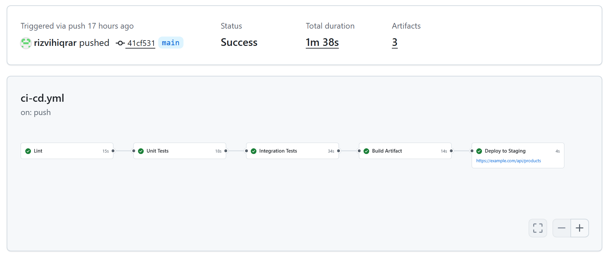
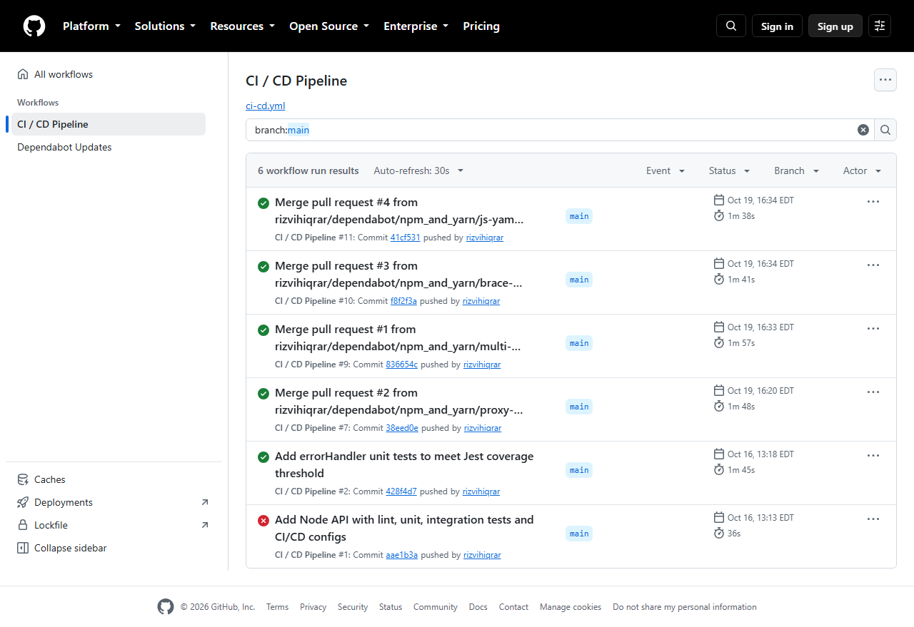
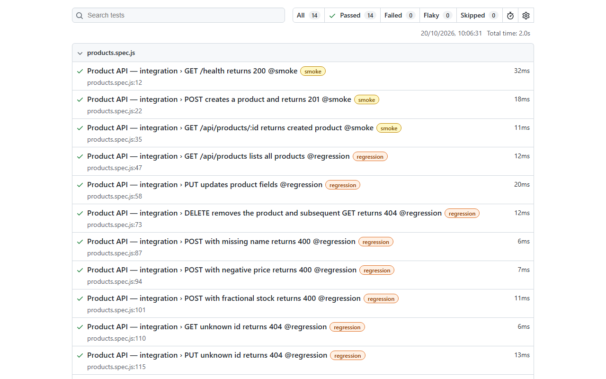
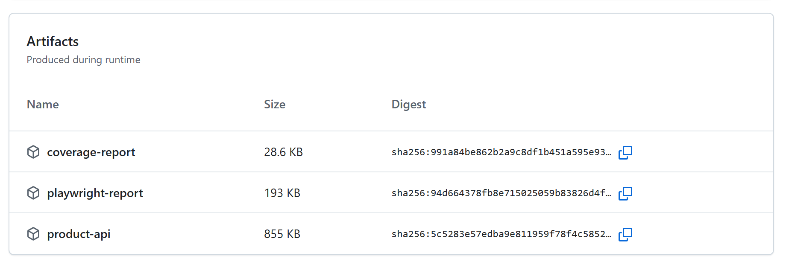

# Technical guide

[← Back to overview](README.md)

How the pipeline is built, how the three platforms differ, and how to run and change it.

## Contents

- [Features](#features)
- [Three-platform comparison](#three-platform-comparison)
- [Configuration](#configuration)
- [CI integration](#ci-integration)
- [API](#api)
- [Test coverage](#test-coverage)
- [FAQ](#faq)
- [Troubleshooting](#troubleshooting)
- [Development](#development)
- [Project structure](#project-structure)

## Features

### Five stages that gate each other

```
lint ──► unit-test ──► integration-test ──► build-artifact ──► deploy
```

Each stage only runs when the previous one passes. Failing tests block the artifact build, and a failed build blocks the deploy.

| Stage | What it does |
|---|---|
| `lint` | ESLint code quality gate |
| `unit-test` | Jest unit tests, with the coverage report published as an artifact |
| `integration-test` | Playwright API tests against a live Express server |
| `build-artifact` | Packages the app into a tarball and uploads it as a pipeline artifact |
| `deploy` | Downloads the artifact and deploys to staging, with a **manual gate required** |

<a href="docs/assets/actions-run.png">
  <picture>
    <source media="(prefers-color-scheme: dark)" srcset="docs/assets/actions-run-dark.png">
    
  </picture>
</a>

*The job graph of a real run on main, with the time each stage took. The deploy job links to its `staging` environment URL.*

#### Limits

- Only the GitHub Actions workflow runs from this repository's checks. The GitLab CI and Azure DevOps files express the same pipeline in their own syntax.
- The deploy step is simulated: it checks the artifact and prints what a real deploy would do.

### Tests that block a bad build

Unit tests run first, because they are fast. Integration tests then start a real Express server and call it over HTTP, so a break in routing, validation or headers is caught before anything is packaged. When the first run on main failed at the unit-test stage, the later stages were skipped:

<a href="docs/assets/actions-workflow-runs.png">
  
</a>

*The workflow's run history on main. The failed run is the first one; the next commit added the tests that met the coverage threshold.*

<a href="docs/assets/playwright-report.png">
  
</a>

*The Playwright report from a local run of `npm run test:integration`. The integration job uploads the same report as a build artifact.*

### Artifacts that carry the evidence

Each run keeps three artifacts: the coverage report, the Playwright report and the packaged app.

<a href="docs/assets/actions-artifacts.png">
  
</a>

*The Artifacts table of a real run.*

| Artifact | Made by | Kept for |
|---|---|---|
| `coverage-report` | `unit-test` | 30 days |
| `playwright-report` | `integration-test` | 30 days |
| `product-api` (`product-api.tar.gz`) | `build-artifact` | 7 days |

The tarball holds `src`, `server.js`, `package.json`, `package-lock.json` and production `node_modules` only. Tests, coverage, the Playwright report and `.git` are excluded.

## Three-platform comparison

The same pipeline logic is expressed in three different CI/CD syntaxes:

| Platform | Config file | Job gating | Artifact handoff | Deploy gate |
|---|---|---|---|---|
| **GitHub Actions** | [`.github/workflows/ci-cd.yml`](.github/workflows/ci-cd.yml) | `needs:` | `upload-artifact` / `download-artifact` | `environment: staging` + required reviewers |
| **GitLab CI** | [`.gitlab-ci.yml`](.gitlab-ci.yml) | `needs:` + `stages:` | `artifacts: paths:` | `when: manual` |
| **Azure DevOps** | [`azure-pipelines.yml`](azure-pipelines.yml) | `dependsOn:` | `PublishBuildArtifacts` / `DownloadBuildArtifacts` | `deployment:` job + `environment:` approval |

### Key syntax differences

```yaml
# Job dependency — "don't run until X passes"
GitHub Actions:  needs: [unit-test]
GitLab CI:       needs: [unit-test]
Azure DevOps:    dependsOn: UnitTest

# Artifact — pass a file from one job to the next
GitHub Actions:  uses: actions/upload-artifact@v4   /   actions/download-artifact@v4
GitLab CI:       artifacts: paths: [artifact/]       /   (auto-downloaded via needs:)
Azure DevOps:    PublishBuildArtifacts@1             /   DownloadBuildArtifacts@0

# Deploy gate — require a human to approve before deploy runs
GitHub Actions:  environment: staging  (add reviewers in Settings → Environments)
GitLab CI:       when: manual          (click Play in the GitLab pipeline UI)
Azure DevOps:    deployment: + environment: staging  (add approvals in Pipelines → Environments)

# Deploy only from main, not PRs
GitHub Actions:  if: github.ref == 'refs/heads/main'
GitLab CI:       only: [main]
Azure DevOps:    condition: eq(variables['Build.SourceBranch'], 'refs/heads/main')
```

### Other differences worth knowing

| Topic | GitHub Actions | GitLab CI | Azure DevOps |
|---|---|---|---|
| Node setup | `actions/setup-node@v4` | `node:20-alpine` image | `NodeTool@0` (`20.x`) |
| Browsers for integration tests | `npx playwright install chromium --with-deps` | `mcr.microsoft.com/playwright:v1.49.0-noble` image | `npx playwright install chromium --with-deps` |
| Coverage | Uploaded as the `coverage-report` artifact | Artifact, plus a `coverage:` regex and a Cobertura report for the GitLab UI | `PublishCodeCoverageResults@2` plus a `coverage-report` pipeline artifact |
| Triggers | Push and pull request to `main` | Defaults | Push and pull request to `main` |

## Configuration

The pipeline is configured by a few files. Defaults come from the files in the repository.

| Setting | Where | Value | What it does |
|---|---|---|---|
| Node version | Workflow and pipeline files | `20` | Runtime for every job |
| Coverage minimum | [`jest.config.cjs`](jest.config.cjs) `coverageThreshold.global.lines` | `80` | Unit-test job fails below 80% line coverage |
| Coverage scope | [`jest.config.cjs`](jest.config.cjs) `collectCoverageFrom` | `src/**/*.js` | Which files count toward coverage |
| Port | `PORT` environment variable | `3001` | Port the API listens on |
| Integration base URL | [`playwright.config.js`](playwright.config.js) `use.baseURL` | `http://localhost:3001` | Where the tests send requests |
| Server start | [`playwright.config.js`](playwright.config.js) `webServer` | `node server.js`, 10 s timeout | Playwright starts the API itself and waits for `/health` |
| Test timeout | [`playwright.config.js`](playwright.config.js) `timeout` | `15000` ms | Per-test limit |
| Retries | [`playwright.config.js`](playwright.config.js) `retries` | `0` | A failing test fails the job |
| Reporters | [`playwright.config.js`](playwright.config.js) `reporter` | `html` (to `playwright-report/`) and `list` | Report uploaded as an artifact |
| Staging gate | GitHub: Settings → Environments → `staging` | Required reviewers | Pauses the deploy until a person approves |
| Artifact retention | Workflow file `retention-days` | 30 (reports), 7 (package) | How long artifacts are kept |

## CI integration

The GitHub Actions workflow is [`.github/workflows/ci-cd.yml`](.github/workflows/ci-cd.yml). It runs on pushes and pull requests to `main`. The deploy job only runs on `main`. Each job lists the previous one under `needs:`:

```yaml
on:
  push:
    branches: [main]
  pull_request:
    branches: [main]

jobs:
  lint:
    runs-on: ubuntu-latest
    steps:
      - uses: actions/checkout@v4
      - uses: actions/setup-node@v4
        with: { node-version: 20, cache: npm }
      - run: npm ci
      - run: npm run lint

  unit-test:
    needs: lint
    runs-on: ubuntu-latest
    steps:
      # ...checkout, setup-node, npm ci...
      - run: npm run test:unit -- --coverage --coverageReporters=text --coverageReporters=lcov
      - uses: actions/upload-artifact@v4
        if: always()
        with: { name: coverage-report, path: coverage/, retention-days: 30 }
```

The deploy job is gated by a GitHub Environment:

```yaml
  deploy:
    name: Deploy to Staging
    needs: build-artifact
    if: github.ref == 'refs/heads/main'
    runs-on: ubuntu-latest
    environment:
      name: staging
      url: https://example.com/api/products
    steps:
      - uses: actions/download-artifact@v4
        with: { name: product-api }
      # ...verify the tarball, then the simulated deploy
```

The same gate in GitLab CI and Azure DevOps:

```yaml
# .gitlab-ci.yml
deploy:
  stage: deploy
  needs: [build-artifact]
  when: manual
  only:
    - main
```

```yaml
# azure-pipelines.yml
- stage: Deploy
  dependsOn: BuildArtifact
  condition: and(succeeded(), eq(variables['Build.SourceBranch'], 'refs/heads/main'))
  jobs:
  - deployment: DeployToStaging
    environment: staging
```

To make the GitHub deploy wait for a person, add required reviewers under **Settings → Environments → staging**. Dependabot pull requests run through the same workflow before they are merged.

## API

| Method | Path | Description |
|---|---|---|
| GET | `/health` | Health check |
| GET | `/api/products` | List all products |
| GET | `/api/products/:id` | Get product by ID |
| POST | `/api/products` | Create a product |
| PUT | `/api/products/:id` | Update a product |
| DELETE | `/api/products/:id` | Delete a product |

**Product schema:**

```json
{
  "id": 1,
  "name": "Widget",
  "category": "Tools",
  "price": 9.99,
  "stock": 50,
  "createdAt": "2025-01-01T00:00:00.000Z"
}
```

| Layer | Tool |
|---|---|
| API | Node.js, Express |
| Unit tests | Jest, Supertest |
| Integration tests | Playwright (API mode) |
| Linting | ESLint 9 |
| CI/CD | GitHub Actions, GitLab CI, Azure DevOps |

## Test coverage

**Unit tests** (`tests/unit/`, 42 tests):

- `productService.test.js`: create, getAll, getById, update, remove, and the validation rules
- `routes.test.js`: route handlers tested with a mock-injected service (the same pattern as Moq in C# unit testing), covering the 200, 201, 204, 400 and 404 paths
- `errorHandler.test.js`: the error-handling middleware

**Integration tests** (`tests/integration/`, 14 tests):

- Full CRUD flow against a live Express server
- Validation error responses (missing name, negative price, fractional stock)
- 404 cases for unknown IDs
- Response header checks (`Content-Type` present, `X-Powered-By` absent)

Tests carry an `@smoke` or `@regression` tag in the title, so a subset can be run with Playwright's `--grep`.

Line coverage is 81.8% against the 80% minimum. `src/app.js` shows 0% in the unit run because the unit tests call the services and routes directly; the integration tests are what start the app.

## FAQ

### Why is the deploy only simulated?

The pipeline is the demonstration. The deploy job downloads the real artifact, checks it and prints what a real deploy would do (copy the tarball to a server, push a container image, or call a deploy hook). It needs no credentials or hosting.

### Why does the routes test inject a mock service?

[`src/routes/products.js`](src/routes/products.js) is a route factory that takes its service as an argument. That lets `routes.test.js` test the HTTP behaviour without the real in-memory store, while the integration tests cover the real wiring.

### Why is `server.js` separate from `src/app.js`?

So tests can import the app without starting a server. `server.js` only reads `PORT` and calls `listen`.

### Why one pipeline on three platforms?

Teams move between CI systems. The comparison tables show that the ideas are the same (order, artifacts, a human gate, deploy only from main) and only the syntax changes.

## Troubleshooting

| Problem | Cause | Fix |
|---|---|---|
| `npm run test:integration` fails with a port error | Something else is using port 3001 | Stop that process, or set `PORT` and the Playwright `baseURL` to match |
| Unit-test job fails with a coverage message | Line coverage fell below 80% | Add tests, or run `npm run test:unit -- --coverage` to see uncovered lines |
| Integration job fails on a fresh machine with a missing browser | Playwright browsers are not installed | Run `npx playwright install chromium` |
| Deploy job never starts | It waits for approval, or the run is not on `main` | Approve it under the run's **Review deployments**, or check the branch |
| Deploy job is skipped on a pull request | `if: github.ref == 'refs/heads/main'` | Expected: only `main` deploys |
| Lint passes locally but fails in CI | Different Node or dependency versions | Use Node 20 and `npm ci`, as CI does |

## Development

```bash
npm install
npm run lint              # ESLint
npm run test:unit         # Jest unit tests
npm run test:integration  # Playwright integration tests
npm start                 # API on http://localhost:3001
```

To refresh the screenshots in `docs/assets/`:

```bash
npm run test:integration                       # builds playwright-report/ for the report screenshot
cd scripts/screenshots
npm install && npx playwright install chromium
npm run capture                                # or: npm run capture -- actions-run actions-artifacts
```

The capture script ([`scripts/screenshots/capture.mjs`](scripts/screenshots/capture.mjs)) takes pictures of a real public run on `main` and of the local Playwright report. To use a newer run, change `RUN` in the script.

## Project structure

```
cicd-pipeline-demo/
├── src/
│   ├── services/
│   │   └── productService.js       # Business logic + in-memory store
│   ├── routes/
│   │   └── products.js             # Route factory — accepts service dependency
│   └── middleware/
│       └── errorHandler.js
├── server.js                       # Entry point (separate from app for testability)
├── tests/
│   ├── unit/
│   │   ├── productService.test.js
│   │   ├── routes.test.js
│   │   └── errorHandler.test.js
│   └── integration/
│       └── products.spec.js
├── docs/assets/                    # Banner and screenshots used by the READMEs
├── scripts/screenshots/            # Playwright script that refreshes the screenshots
├── .github/workflows/ci-cd.yml     # GitHub Actions pipeline
├── .gitlab-ci.yml                  # GitLab CI pipeline
├── azure-pipelines.yml             # Azure DevOps pipeline
├── jest.config.cjs
├── playwright.config.js
└── eslint.config.js
```
